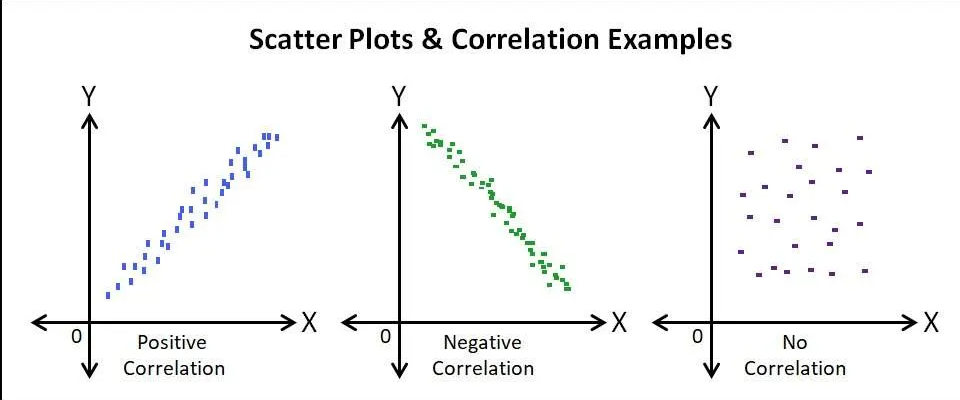
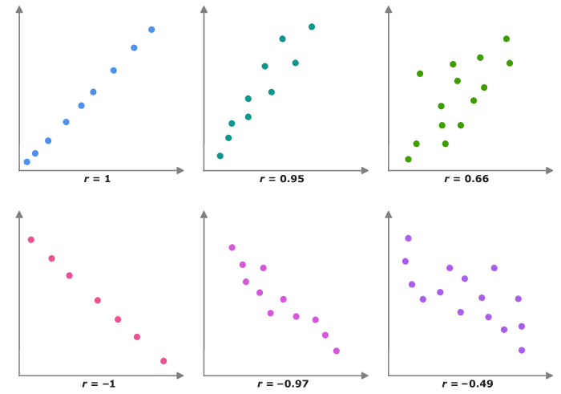

# ¿Qué veremos?

::: {.incremental}
1. Asociación: covarianza vs. correlación
2. Correlación de Pearson
3. Correlación con variables ordinales (y punto-biserial)
4. Matrices y tamaños de efecto en correlación
5. Asociación con variables categóricas
:::

---

## Mapa de la sesión

¿Qué herramienta uso según mis variables?

| Variables | Herramienta |
|---|---|
| Dos cuantitativas | Pearson |
| Una cuantitativa y una dicotómica | Punto-biserial |
| Dos ordinales (o rankings) | Spearman / Kendall |
| Dos nominales | Chi-cuadrado, Phi / V de Cramer |

**Primero identifico el tipo de variable, después elijo la técnica.**

# 1. Introducción a la asociación

---

## ¿Qué es una asociación?

Dos variables están **asociadas** cuando los valores de una cambian junto con los valores de la otra.

Ejemplos:

- ¿Más años de estudio se asocian con más ingreso?
- ¿Más horas de estudio se asocian con mejores notas?

---

Nos interesa saber:

::: {.incremental}
- **Si** existe asociación.
- **Hacia dónde** va (dirección).
- **Qué tan fuerte** es (magnitud).
:::

---

## Covarianza

Mide si dos variables cuantitativas **se mueven juntas**.

::: {.incremental}
- **Positiva:** cuando una sube, la otra tiende a subir.
- **Negativa:** cuando una sube, la otra tiende a bajar.
- **Cercana a cero:** no hay una tendencia lineal clara.
:::

$$
s_{XY} = \frac{\sum (x_i-\bar{x})(y_i-\bar{y})}{n-1}
$$

---

## El problema de la covarianza

Su valor **depende de las unidades** de medida.

Ejemplo: la covarianza entre ingreso y escolaridad cambia si el ingreso está en pesos o en miles de pesos, aunque la relación sea la misma.

Entonces:

- No sirve para comparar relaciones.
- No sabemos si el valor es "grande" o "pequeño".

**Solución: estandarizarla → correlación.**

---

## Covarianza vs. correlación

| | Covarianza | Correlación |
|---|---|---|
| Dice la dirección | Sí | Sí |
| Dice la magnitud | No (depende de las unidades) | Sí |
| Rango | Cualquier valor | Entre -1 y 1 |
| Comparable entre variables | No | Sí |

# 2. Correlación de Pearson

---

## ¿Qué mide Pearson?

La **dirección** y la **fuerza** de la relación **lineal** entre dos variables cuantitativas.

$$
r = \frac{Cov(X,Y)}{S_X S_Y}
$$

Es la covarianza dividida por las desviaciones estándar. Por eso queda entre **-1 y 1**.

---

## Primero: mira el gráfico

Antes de calcular, hay que hacer un **diagrama de dispersión** (cada punto es una persona).

{width="75%" fig-align="center"}

---

## ¿Cómo se lee?

{width="75%" fig-align="center"}

::: {.incremental}
- Puntos que suben de izquierda a derecha → **positiva**.
- Puntos que bajan → **negativa**.
- Puntos muy cerca de una línea → **más fuerte**.
- Nube sin forma → **cercana a 0**.
:::

---

## Interpretación del valor

::: {.incremental}
- $r = 1$: relación lineal positiva perfecta.
- $r = -1$: relación lineal negativa perfecta.
- $r = 0$: no hay relación lineal.
:::

Una regla orientadora (varía según el campo): cerca de 0.1 es débil, de 0.3 moderada y de 0.5 o más fuerte.

**Ojo:** $r = 0$ no descarta una relación no lineal (por eso miramos el gráfico).

---

## Ejemplo

Entre años de escolaridad e ingreso mensual: $r = 0.65$

::: {.incremental}
1. Asociación **positiva**.
2. Magnitud **considerable**.
3. A más escolaridad, tienden a observarse mayores ingresos.
4. **No podemos decir que una cause la otra.**
:::

---

## Precauciones

- Sirve solo para variables **cuantitativas**.
- Mide relaciones **lineales**.
- Es **sensible a valores atípicos**: un solo caso extremo puede cambiar mucho el resultado.

Por eso: **siempre revisar el diagrama de dispersión.**

---

## ¿Es significativa?

Hasta ahora describimos la muestra. Para saber si hay evidencia de asociación en la **población** usamos un contraste:

$$
H_0: \rho = 0 \qquad H_1: \rho \neq 0
$$

- **p < 0.05:** rechazamos H0 (hay evidencia de correlación).
- **p ≥ 0.05:** no rechazamos H0 (no hay evidencia suficiente).

---

# 3. Correlación con variables ordinales

---

## ¿Por qué otros coeficientes?

Pearson necesita variables cuantitativas y relaciones lineales.

Pero muchas variables son **ordinales** (satisfacción, nivel educativo, rankings): tienen orden, pero no distancias iguales.

Para estos casos usamos coeficientes basados en el **orden**.

---

## Relación monótona

Una relación es **monótona** cuando, al subir una variable, la otra **siempre tiende a subir** (o siempre a bajar), aunque no sea en línea recta.

Spearman y Kendall miden este tipo de relación.

---

## Spearman ($\rho_s$)

- Reemplaza los valores por su **posición** (ranking) y calcula la correlación entre rankings.
- Sirve para variables **ordinales** o cuantitativas con relación monótona.
- Va de **-1 a 1**, y se interpreta como Pearson.

---

## Kendall ($\tau$)

- Compara **pares de casos**: ¿van en el mismo sentido o en sentido contrario?
- **Concordante:** quien tiene más en X también tiene más en Y.
- **Discordante:** quien tiene más en X tiene menos en Y.
- También va de **-1 a 1**.

---

## Los empates

Hay **empates** cuando varias personas tienen el mismo valor.

Es común en escalas cortas: muchas personas responden "4" en una escala de 1 a 5.

**Kendall $\tau_b$** corrige por los empates.

---

## ¿Cuál uso?

| Situación | Coeficiente |
|---|---|
| Dos variables cuantitativas, relación lineal | Pearson |
| Variables ordinales o relación monótona | Spearman |
| Variables ordinales con muchos empates | Kendall ($\tau_b$) |

---

## Otro caso: variable dicotómica

¿Y si una variable es **cuantitativa** y la otra tiene **solo dos categorías**?

- Ingreso y situación laboral (ocupado/desocupado).
- Nota final y aprobación (sí/no).
- Edad y participación electoral (sí/no).

Para esto usamos la **correlación punto-biserial**.

---

## Punto-biserial ($r_{pb}$)

Mide la asociación entre:

- Una variable **cuantitativa**.
- Una variable **dicotómica** (codificada 0 y 1).

Es equivalente a Pearson cuando la variable dicotómica se codifica 0/1.

La idea: **¿qué tan distintas son las medias de los dos grupos?**

---

## Ejemplo punto-biserial

Participación en tutorías (0 = no, 1 = sí) y nota final: $r_{pb} = 0.42$

::: {.incremental}
1. Asociación **positiva**.
2. Quienes participan tienden a tener **notas mayores**.
3. Magnitud: 0.42.
4. **No podemos afirmar que las tutorías causen mejores notas.**
:::

Si invertimos la codificación 0/1, **cambia el signo** del coeficiente.

---

## Resumen: ¿cuál coeficiente?

| Variables | Coeficiente |
|---|---|
| Edad e ingreso | Pearson |
| Satisfacción y confianza (ordinales) | Spearman / Kendall |
| Participación (sí/no) y nota | Punto-biserial |
| Dos rankings | Spearman / Kendall |

# 4. Matrices y tamaños de efecto en correlación

---

## ¿Qué es una matriz de correlación?

Una tabla que muestra **todas las correlaciones** entre varias variables a la vez.

| Variable | Edad | Ingreso | Escolaridad |
|---|---:|---:|---:|
| Edad | 1.00 | 0.35 | -0.12 |
| Ingreso | 0.35 | 1.00 | 0.68 |
| Escolaridad | -0.12 | 0.68 | 1.00 |

---

## ¿Cómo se lee?

::: {.incremental}
1. La **diagonal** son unos (cada variable con ella misma).
2. Es **simétrica** (Edad-Ingreso = Ingreso-Edad).
3. Cada celda es la correlación de **un par** de variables.
4. Más fuerte: Ingreso-Escolaridad (0.68). Negativa: Edad-Escolaridad (-0.12).
:::

---

## En R

```{r}
datos <- data.frame(
  edad = c(20, 25, 30, 35, 40, 45),
  ingreso = c(450, 500, 650, 700, 850, 900),
  escolaridad = c(12, 14, 16, 15, 18, 17)
)

cor(datos, method = "pearson")
```

---

### Matriz visual

```{r}
#| fig-width: 6
#| fig-height: 5
library(corrplot)

matriz_cor <- cor(datos, method = "pearson")

corrplot(matriz_cor,
         method = "color",
         type = "upper",
         addCoef.col = "black",
         tl.col = "black",
         title = "Matriz de correlación (Pearson)",
         mar = c(0, 0, 2, 0))

        
```

---

### Matriz de círculos

```{r}
#| fig-width: 6
#| fig-height: 5
corrplot(matriz_cor,
         method = "circle",
         type = "upper",
         tl.col = "black",
         title = "Matriz de correlación (círculos)",
         mar = c(0, 0, 2, 0))
```

---

## Casos perdidos (NA)

En datos reales hay respuestas que faltan. En R se llaman `NA`.

| Persona | Edad | Ingreso | Escolaridad |
|---|---:|---:|---:|
| A | 20 | 450 | 12 |
| B | 25 | NA | 14 |
| C | 30 | 650 | NA |
| D | 35 | 700 | 16 |
| E | 40 | 850 | 18 |

¿Qué hacemos con ellos? Dos opciones: **listwise** y **pairwise**.

---

## Listwise (casos completos)

Se usan **solo las personas sin ningún NA** en las variables de la matriz.

| Persona | ¿Se incluye? |
|---|---|
| A | Sí |
| B | No (NA en ingreso) |
| C | No (NA en escolaridad) |
| D | Sí |
| E | Sí |

Todas las correlaciones usan **los mismos 3 casos**.

```{r}
#| eval: false
cor(datos_na, use = "complete.obs")
```

---

## Pairwise (pares disponibles)

Cada correlación usa **todas las personas que tienen datos en ese par**.

| Correlación | Casos usados |
|---|---:|
| Edad - Ingreso | 4 |
| Edad - Escolaridad | 4 |
| Ingreso - Escolaridad | 3 |

Cada correlación puede tener un **n distinto**.

```{r}
#| eval: false
cor(datos_na, use = "pairwise.complete.obs")
```

---

## Listwise vs. pairwise

| | Listwise | Pairwise |
|---|---|---|
| Casos usados | Solo completos | Los disponibles por par |
| Tamaño muestral | Igual para toda la matriz | Puede variar |
| Aprovecha más datos | Menos | Más |
| Problema | Se pierden muchos casos | Cada coeficiente usa una muestra distinta |

**No hay una opción universal: hay que justificar y reportar cuál se usó.**

---

## Tamaño del efecto

**Tamaño del efecto = qué tan grande es la asociación**, independiente del tamaño de la muestra.

- El **p-valor** dice si hay evidencia de asociación en la población.
- El **tamaño del efecto** dice **cuánta** asociación hay.

En correlación, el propio coeficiente ($r$, $\rho_s$, $\tau$, $r_{pb}$) es un tamaño del efecto.

---

## ¿Cómo interpretar la magnitud?

Referencia habitual (Cohen), usando $|r|$:

| |r| | Magnitud |
|---|---|
| ≈ 0.10 | Pequeña |
| ≈ 0.30 | Mediana |
| ≈ 0.50 o más | Grande |

Son **convenciones orientadoras**: la interpretación depende del contexto de la investigación.

---

## Coeficiente de determinación ($r^2$)

Elevar $r$ al cuadrado indica la **proporción de variación compartida** entre las variables (en Pearson).

| r | r² | Se comparte |
|---|---|---|
| 0.30 | 0.09 | 9% |
| 0.50 | 0.25 | 25% |
| 0.70 | 0.49 | 49% |

Ejemplo: $r = 0.65$ → $r^2 \approx 0.42$ → comparten cerca del **42%** de su variación.

---

## Magnitud vs. significación

| Variables | r | p |
|---|---:|---:|
| Escolaridad e ingreso | 0.62 | 0.001 |
| Edad y satisfacción | -0.12 | 0.280 |
| Horas de estudio y nota | 0.41 | 0.012 |

::: {.incremental}
- Mayor tamaño del efecto: escolaridad e ingreso.
- Significativas: la 1.ª y la 3.ª.
- Con muestras muy grandes, **un $r$ minúsculo puede ser significativo** sin ser importante.
:::

---

## ¿Qué reportar?

::: {.incremental}
1. El **coeficiente** (dirección y magnitud).
2. El **p-valor** (evidencia).
3. El **n** utilizado (sobre todo con pairwise).
4. Una **interpretación sustantiva**, sin hablar de causalidad.
:::

# 5. Asociación con variables categóricas

---

## ¿Y si las variables son categorías?

Para dos variables **nominales** (sexo, preferencia electoral, comuna) no se usa Pearson.

Usamos:

::: {.incremental}
- **Tablas de contingencia** para ver los datos.
- **Chi-cuadrado** para saber si hay asociación.
- **Phi / V de Cramer** para saber su magnitud.
:::

---

## Tabla de contingencia

Cruza dos variables. Ejemplo con 100 personas:

| | Usa transporte público | No usa | Total |
|---|---:|---:|---:|
| Mujeres | 35 | 15 | 50 |
| Hombres | 20 | 30 | 50 |
| Total | 55 | 45 | 100 |

Porcentajes por fila: usa transporte público el **70%** de las mujeres y el **40%** de los hombres.

¿Parece haber asociación?

---

## Independencia

Dos variables son **independientes** si la distribución de una **no cambia** según la otra.

Si sexo y transporte fueran independientes, el porcentaje que usa transporte público sería **similar** en hombres y mujeres.

Chi-cuadrado compara lo que **observamos** con lo que **esperaríamos** si fueran independientes.

---

## Chi-cuadrado: la idea

$$
\chi^2 = \sum \frac{(O-E)^2}{E}
$$

- **O:** frecuencia observada.
- **E:** frecuencia esperada si fueran independientes.

Mientras **más se alejan** O y E, **mayor** es el chi-cuadrado.

$H_0$: las variables son independientes.
$H_1$: las variables están asociadas.

---

## Frecuencias esperadas

$$
E_{ij} = \frac{Total\ fila_i \times Total\ columna_j}{n}
$$

Mujeres que usan transporte: $E = \frac{50 \times 55}{100} = 27.5$

| | Usa transporte | No usa |
|---|---:|---:|
| Mujeres | 27.5 | 22.5 |
| Hombres | 27.5 | 22.5 |

---

## Cálculo e interpretación

Sumamos $(O-E)^2/E$ de las cuatro celdas:

$$
\chi^2 \approx 9.09
$$

Grados de libertad: $gl = (filas-1)(columnas-1) = 1$

Resultado: $\chi^2(1) = 9.09,\ p \approx 0.003$

Como $p < 0.05$, **rechazamos H0**: hay evidencia de asociación entre sexo y uso de transporte público.

---

## En R

```{r}
tabla <- matrix(
  c(35, 20, 15, 30),
  nrow = 2,
  dimnames = list(
    Sexo = c("Mujeres", "Hombres"),
    Transporte = c("Usa", "No usa")
  )
)

chisq.test(tabla, correct = FALSE)
```

---

## Precauciones

- Se usan **frecuencias** (conteos), no porcentajes.
- Las observaciones deben ser **independientes**.
- Las frecuencias esperadas no deben ser muy pequeñas (regla habitual: al menos 5 por celda).

**Chi-cuadrado solo dice si hay asociación. No dice qué tan fuerte es ni si hay causalidad.**

---

## Phi y V de Cramer: el tamaño del efecto

Son los **tamaños del efecto** para variables categóricas: miden **qué tan fuerte** es la asociación, de 0 a 1.

**Phi** (tablas 2x2):

$$
|\phi| = \sqrt{\frac{\chi^2}{n}} = \sqrt{\frac{9.09}{100}} \approx 0.30
$$

**V de Cramer** (cualquier tamaño de tabla):

$$
V = \sqrt{\frac{\chi^2}{n \cdot \min(r-1,\,c-1)}}
$$

En una tabla 2x2, V es igual al valor absoluto de Phi.

---

## Interpretación

::: {.incremental}
- Cerca de **0**: asociación débil.
- Cerca de **1**: asociación fuerte.
- **No indican la dirección** de la relación.
:::

En nuestro ejemplo: hay asociación significativa ($p \approx 0.003$) y de magnitud **moderada** ($\phi \approx 0.30$).

---

## Resumen: ¿qué sirve para qué?

| Pregunta | Herramienta |
|---|---|
| ¿Hay asociación? | Chi-cuadrado (p-valor) |
| ¿Qué tan fuerte es? | Phi (2x2) o V de Cramer |
| ¿Cómo se ve? | Tabla de contingencia (porcentajes) |

---

# Para la prueba, recuerden:

::: {.incremental}
1. Identificar el **nivel de medición** de las variables.
2. Elegir la técnica: **Pearson**, **punto-biserial**, **Spearman/Kendall** o **chi-cuadrado**.
3. Mirar el **gráfico o la tabla** antes de calcular.
4. Interpretar la **magnitud (tamaño del efecto) y la dirección**, y revisar el **p-valor**.
5. Si hay NA, decir si usaron **listwise o pairwise**.
6. Concluir con palabras: **asociación no es causalidad**.
:::

# Escoge el coeficiente

::: {.incremental}
- Años de estudio e ingreso 
- Satisfacción laboral (1-5) y estrés (1-5)
- Asistió a tutorías (sí/no) y nota final
- Región de residencia y medio de transporte
- Sexo y uso de redes sociales (sí/no)
- Posición de 10 ciudades en dos rankings de seguridad
:::

---

# Escoge el coeficiente 

::: {.incremental}
- Edad y votó en la última elección (sí/no)
- Horas de sueño y minutos de ejercicio a la semana
- Nivel educativo (3 niveles) y confianza en el gobierno (4 niveles)
- Ocupación y religión
:::


# Nos vemos la próxima sesión!

Grupo de Estudio de Estadística Correlacional

Centro IDEA - FACSO
